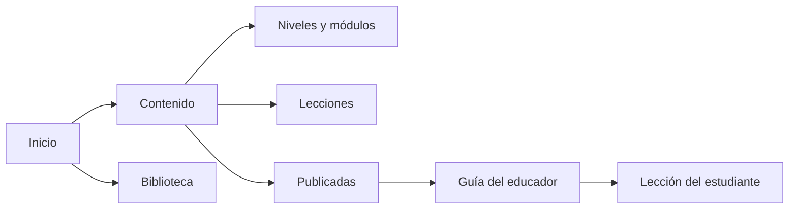

# Rediseño: primera entrega de implementación

29 de septiembre de 2026 · ST-041 / HL-44

**Dirección revisada:** [Cursos, recorridos y contenido compartido](modelo-educativo-generico.md) sustituye la jerarquía académica fija de esta primera entrega. Incluye taxonomías configurables, flujos, estados, progresión y [wireframes navegables](prototipo-cursos.html). El resto de esta página conserva el alcance realmente implementado; no presenta la nueva propuesta como desplegada.

## Aprobación

El usuario confirmó que la revisión pedagógica está aprobada y autorizó comenzar la implementación del plan de rediseño. No se solicita otra revisión de los mismos contenidos. Esta nota registra la confirmación recibida; no atribuye la revisión a una persona ni inventa su fecha original.

El [contenido editorial aprobado](../../database/seeds/editorial-2026-09-29.json) queda versionado: un nivel, dos módulos, cinco lecciones, diez recursos y dos grupos sin datos de participantes. Contiene actividades completas, orientaciones para el educador y retroalimentación. **Todavía no se ha cargado en producción.** La aprobación pedagógica no equivale a una publicación técnica ya realizada.

## Resultado de esta entrega

- Un marco de navegación para Inicio, Contenido, Biblioteca y administración según permisos.
- Rutas propias: recargar o utilizar Atrás no vuelve al inicio. Los filtros de Biblioteca se conservan en la URL.
- Inicio sin bloque promocional: accesos de trabajo y hasta tres lecciones publicadas.
- Tarjetas separadas por 24 px en escritorio y 16 px en móvil.
- Módulo sustituye a Unidad en los controles. Se conservan `units`, sus IDs, relaciones y publicaciones.
- Aviso al abandonar una edición sin guardar, también al usar Atrás o cerrar la página. No es guardado automático.
- Enlaces públicos anteriores conservados; también se admite `/aprender/:codigo`.
- Pruebas de escritura solo contra un servidor local con almacenamiento nuevo por ejecución. En producción se permite lectura, inicio y cierre de sesión, pero no editar contenido ni aumentar finalizaciones.

No se presentan Grupos, Revisiones ni presencia de colaboradores como funcionalidades disponibles antes de implementarlas.

Capturas de la aplicación ejecutada localmente con su base aislada, no del prototipo ni de producción: [escritorio](inicio-escritorio.png) y [móvil](inicio-movil.png). Muestran el contenido anterior porque la carga editorial todavía no se ha aplicado.

## Diseño aplicado

| Uso | Color |
| --- | --- |
| Fondo | `#F5F7FB` |
| Superficie | `#FFFFFF` |
| Texto principal | `#172B4D` |
| Texto secundario | `#52617A` |
| Acción principal | `#2455D6` |
| Fondo de selección | `#EEF3FF` |
| Contorno de controles | `#7D8DA5` |
| Foco de teclado | `#7C3AED` |
| Confirmación / advertencia / error | `#166534` / `#854D0E` / `#B42318` |

Texto base de 16 px, controles de al menos 44 px y tarjetas con radio de 12 px. No se descargan fuentes externas. La experiencia del estudiante no incorpora navegación administrativa.



## Límites y siguiente entrega

El editor actual sigue utilizando campos de texto y guardado explícito. Aún faltan el editor enriquecido, las páginas de edición separadas, los estados de revisión y la coedición simultánea. Se implementarán sobre los contratos actuales con migraciones acumulativas, sin cambiar de stack.

La nueva carga editorial y el archivo reversible de datos antiguos se harán juntos, identificando cada registro antes de modificarlo. Esta entrega **no elimina, renombra ni oculta por patrón los datos existentes**. Impide que las siguientes pruebas de entrega sigan añadiendo contenido artificial a producción.

Los formularios advierten antes de salir, pero no recuperan datos tras una pérdida abrupta del navegador. Los grupos y las asignaciones permanecen dentro de la siguiente entrega. No se reabre Sprint 2 ni se mueve ningún tag publicado.

## Verificación y despliegue

```bash
./scripts/verify
npm run test:e2e
npm run test:smoke
```

`test:e2e` rechaza cualquier `BASE_URL` externo antes de iniciar pruebas. `test:smoke` admite `BASE_URL` y bloquea en el navegador cualquier escritura excepto `/api/login` y `/api/logout`. Los tests mutantes añaden una segunda protección contra destinos remotos.

Las pruebas de navegación verifican móvil y escritorio, separación real entre tarjetas, foco visible, recarga, Atrás/Adelante, filtros persistentes y protección del borrador. Se conservan los recorridos de Sprint 1 y Sprint 2. Las capturas proceden de la aplicación ejecutada, no del prototipo.

Validación local de esta entrega: 23 pruebas Vitest, 13 pruebas Python, 8 E2E de escritorio/móvil y 2 smoke de solo lectura aprobados. Las 46 claves del seed son únicas; se comprobaron relaciones, duración de actividades, respuestas y ausencia de participantes. El rechazo de `test:e2e` con la URL de producción se comprobó antes de cualquier conexión.

Para abrir rutas directamente, se utiliza el [modo SPA de Workers Static Assets](https://developers.cloudflare.com/workers/static-assets/routing/single-page-application/). `/api/*` conserva prioridad del Worker y sus controles de autorización. No se añaden bindings, servicios, migraciones ni dependencias.

Rollback: revertir el commit de entrega mediante PR y desplegar el artefacto verificado. No hace falta revertir datos. Mantener la separación de pruebas mutantes y smoke aunque se revierta la interfaz.
