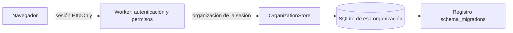
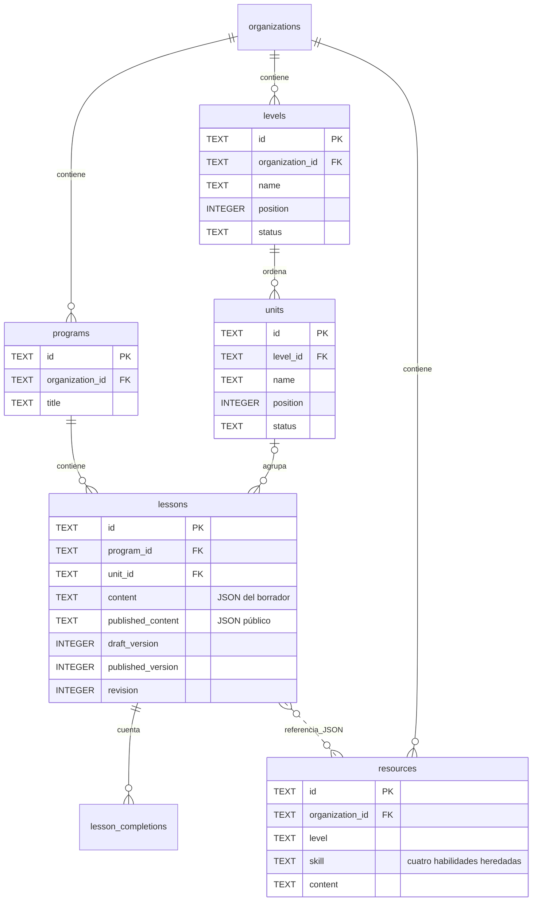
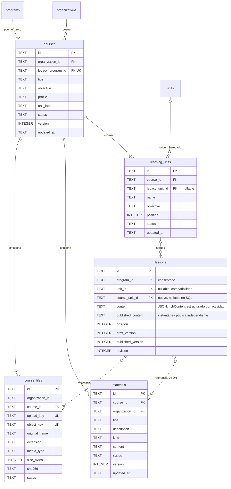
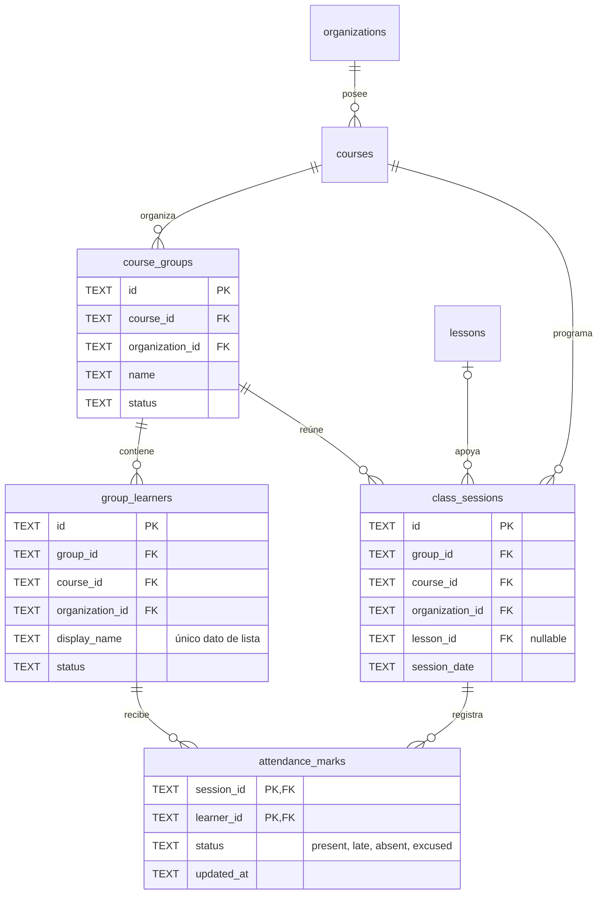
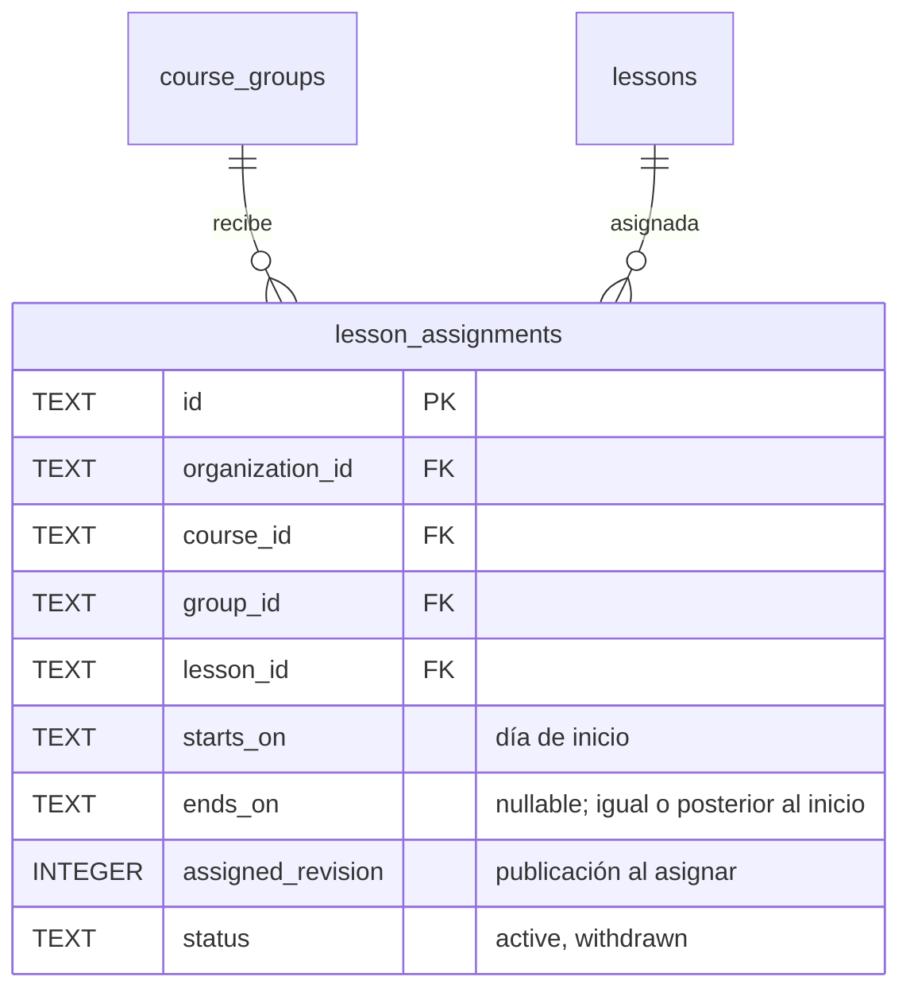
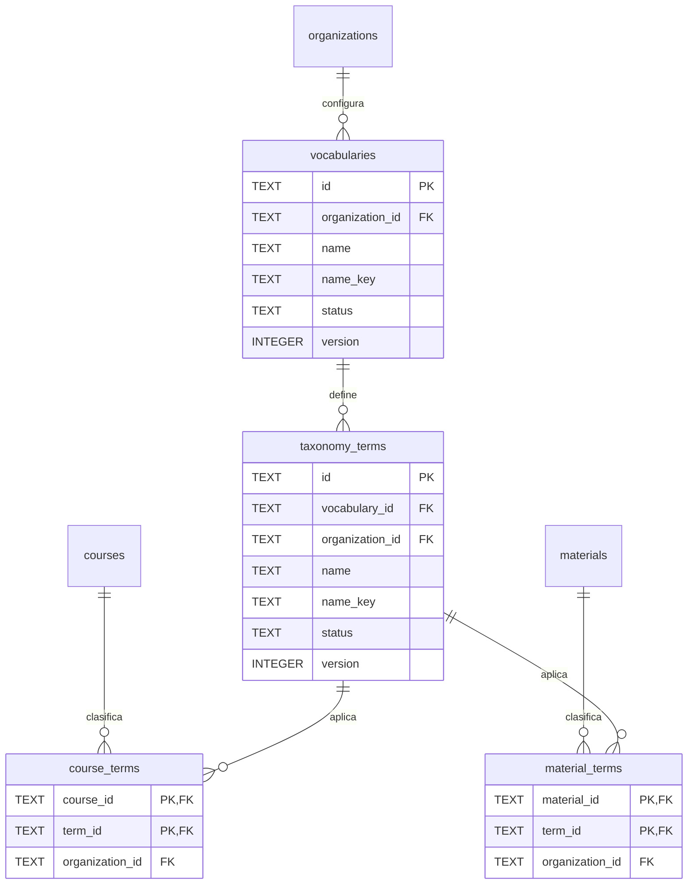
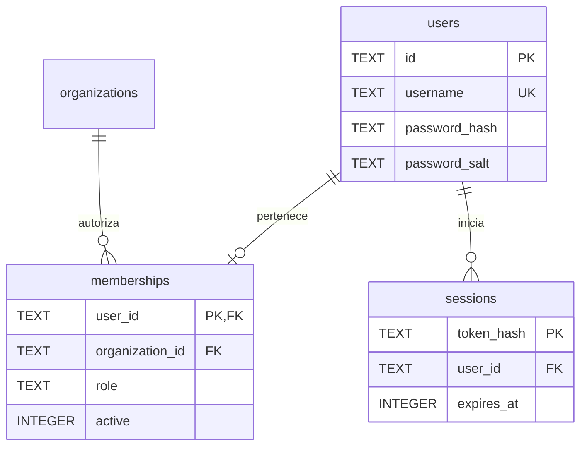
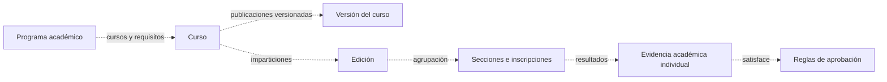

# Base de datos: cursos y clasificación

Esquema de las migraciones [0007_courses.sql](../../database/migrations/0007_courses.sql) y [0008_classroom_attendance.sql](../../database/migrations/0008_classroom_attendance.sql). Los diagramas de esta página representan tablas existentes y nuevas implementadas, no funcionalidades futuras.

## Persistencia y aislamiento

Se conserva SQLite en el Durable Object de cada organización. El Worker resuelve la organización desde la sesión, no desde un campo enviado por el navegador. No se añaden D1, R2 ni servicios externos. El despliegue conserva el binding y la identidad del almacenamiento.



La demostración mantiene las dos organizaciones preexistentes. Esta entrega no habilita registro público de instituciones ni alumnos. Las sesiones y credenciales de demostración no deben utilizarse para datos personales reales.

## Antes: esquema conservado

Las relaciones continuas representan claves foráneas. La relación discontinua de recursos indica una referencia dentro del JSON, no una clave foránea.



`programs` era un contenedor técnico de lecciones. No acredita estudios ni representa el programa académico del diseño futuro. Su nombre se conserva únicamente por compatibilidad. Las habilidades obligatorias permanecen en `resources`; **los materiales nuevos no utilizan esa tabla**.

## Ahora: curso como espacio de autoría



`course_files` contiene metadatos y referencias a objetos privados de R2, no el binario. La clave de objeto no se expone al navegador. El borrador referencia el ID del archivo en la actividad; al publicar, la instantánea registra el recurso autorizado y el endpoint público comprueba que el archivo siga vinculado a esa versión.

La colaboración en tiempo real usa un Durable Object por lección, separado de las tablas de curso. SQLite de ese objeto guarda una instantánea Yjs y una secuencia acotada de actualizaciones; presencia y sockets son efímeros. El API comprueba membresía y sesión antes de conectar y mientras procesa mensajes.

## Grupos, clases y asistencia



La API autoriza consulta y escritura de asistencia al rol educador y verifica que grupo, participante, sesión, curso y organización coincidan. La clave primaria compuesta evita duplicar marcas para una persona dentro de una sesión. La migración incluye una lista sintética y no crea sesiones ni resultados históricos.

### Asignaciones de lecciones



`0016_lesson_assignments.sql` asigna una lección publicada a un grupo del mismo curso durante un periodo. La API rechaza borradores, lecciones sin publicar y archivadas. La asignación conserva la publicación con la que se hizo: si la lección se vuelve a publicar se identifica como actualizada, y si se archiva o pierde su publicación requiere sustitución. Retirar una asignación conserva el registro con estado `withdrawn`.

Un curso puede existir sin unidades ni programa académico. Una lección nueva necesita una unidad activa del curso. No hay anidamiento ilimitado. Los perfiles cambian el vocabulario inicial; no crean reglas de evaluación ni requisitos inferidos.

La API verifica que la unidad y la lección pertenezcan al mismo curso. La columna heredada `program_id` sigue siendo obligatoria: al crear un curso se crea su contenedor de compatibilidad en la misma transacción. El JSON y las columnas de relación se actualizan juntos al guardar una lección.

### Clasificación independiente



Las claves foráneas compuestas incluyen `organization_id`: una clasificación no puede enlazarse con un curso o material de otra organización. La API rechaza términos inexistentes y nuevas referencias a términos archivados. Archivar no elimina las clasificaciones ya asignadas.

| Tabla | Restricciones adicionales |
| --- | --- |
| `courses` | `legacy_program_id` único; `(id, organization_id)` único; perfil y etiqueta con valores permitidos; versión positiva |
| `learning_units` | `(course_id, legacy_unit_id)` único cuando existe origen; `(id, course_id)` único; posición no negativa |
| `vocabularies` | `(organization_id, name_key)` único |
| `taxonomy_terms` | `(vocabulary_id, name_key)` único; vocabulario y organización deben coincidir |
| `course_terms` | PK `(course_id, term_id)`; ambas FK incluyen organización |
| `materials` | FK `(course_id, organization_id)`; tipo texto/enlace; sin campos de idioma obligatorios |
| `material_terms` | PK `(material_id, term_id)`; ambas FK incluyen organización |

Los nombres se normalizan a Unicode NFC; la clave de unicidad usa minúsculas. Los IDs nunca se muestran como nombres del contenido. Los índices nuevos cubren cursos por organización/estado, unidades por curso/posición, lecciones por unidad/posición y materiales por curso/estado.

## Identidad y acceso: sin cambios de modelo



Administración gestiona vocabularios y permisos. Educadores crean y editan cursos, materiales y lecciones. El estudiante abre una publicación sin cuenta. No se añade un padrón de estudiantes ni se reinterpretan las finalizaciones agregadas como aprobación académica.

## Publicación y edición concurrente

`lessons.content` contiene actividades ordenadas. Los vínculos de recursos son referencias JSON comprobadas por la API, no relaciones SQL. Al publicar, `published_content` incluye una copia de los materiales utilizados: cambiar o archivar el original no modifica la publicación anterior. No existe una tabla histórica de todas las revisiones; se conserva la última publicación y el borrador actual.

```mermaid
sequenceDiagram
  participant A as Educador A
  participant B as Educador B
  participant API as Worker
  participant DB as SQLite
  A->>API: Leer versión 4
  B->>API: Leer versión 4
  A->>API: Guardar con versión 4
  API->>DB: UPDATE WHERE version=4 + relaciones, una transacción
  DB-->>A: Guardado, versión 5
  B->>API: Guardar con versión 4
  API->>DB: UPDATE WHERE version=4
  DB-->>B: 409; no se sobrescribe la versión 5
```

El guardado de metadatos del curso y sus clasificaciones es atómico. Ordenar o modificar unidades también exige la versión del curso. Los materiales y las lecciones tienen su propia versión. Esto evita sobrescrituras en esos registros; **no es coedición simultánea**, presencia ni fusión automática. El orden de lecciones conserva el mecanismo anterior, sin versión de colección.

## Migración y recuperación

1. El ledger `schema_migrations` aplica la versión 7 una vez por organización dentro de una transacción SQLite.
2. Cada contenedor anterior se relaciona con un curso mediante `legacy_program_id`. No se crean cursos por cada nivel.
3. Las unidades se mapean por sus lecciones y contenedores. Si una unidad anterior sirve a dos contenedores, cada curso recibe una unidad con referencia al mismo origen. Las unidades sin lecciones se incorporan al primer curso existente de su organización. Si no hay curso, se conservan en las tablas heredadas.
4. Se añade `lessons.course_unit_id`; no se reescriben el contenido, las publicaciones, las revisiones, los recursos ni sus IDs.
5. Se incorpora el vocabulario inicial Disciplina con Artes, Ciencias, Tecnología e Idiomas. No se carga contenido académico de prueba en producción.

Las pantallas heredadas siguen disponibles para compatibilidad. Tras la migración, modificar el nombre de una unidad heredada no renombra automáticamente su copia de autoría en un curso; la configuración nueva se administra desde Cursos. No deben usarse ambas estructuras como fuentes editoriales equivalentes.

La primera opción de rollback es una corrección hacia adelante o revertir la interfaz **conservando el lector del esquema 7**. No ejecutar `DROP`, reconstruir tablas ni borrar el ledger. Desplegar sin más una versión anterior puede ocultar cursos nuevos y no constituye una recuperación completa.

En una incidencia de datos, detener las escrituras, conservar el estado posterior y determinar la organización y el instante afectados antes de restaurar. Cloudflare ofrece recuperación puntual de SQLite durante los últimos 30 días; no se ha ejecutado ni ensayado una restauración remota en esta entrega. La restauración requiere valorar las escrituras que se perderían y autorización específica. [API de almacenamiento y recuperación de Cloudflare](https://developers.cloudflare.com/durable-objects/api/sqlite-storage-api/).

## Diagrama objetivo: todavía no implementado



Este último diagrama es conceptual. No existen aún tablas de programas académicos, ediciones, inscripciones, resultados, requisitos ni sesiones de coedición. Sus migraciones corresponden a incrementos posteriores del [diseño aprobado](modelo-educativo-generico.md).

## Evidencia ejecutable

- [Migraciones](../../tests/test_migrations.py): compara el contenido publicado antes/después, verifica relaciones y rechaza clasificaciones cruzadas.
- [Reglas de dominio](../../tests/courses.test.ts): perfiles, clasificación opcional, límites, URL y orden completo.
- [Recorrido y API](../../tests/e2e/api.spec.ts): autorización del curso, programas, requisitos configurados, versiones y referencias entre cursos; se ejecuta en escritorio y móvil sobre almacenamiento local nuevo.

Los bloques Mermaid se renderizan en GitHub. Sus nombres coinciden con las tablas SQL. El esquema objetivo no se mezcla con el físico desplegable.
