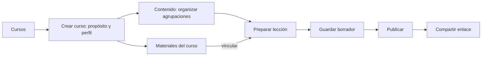
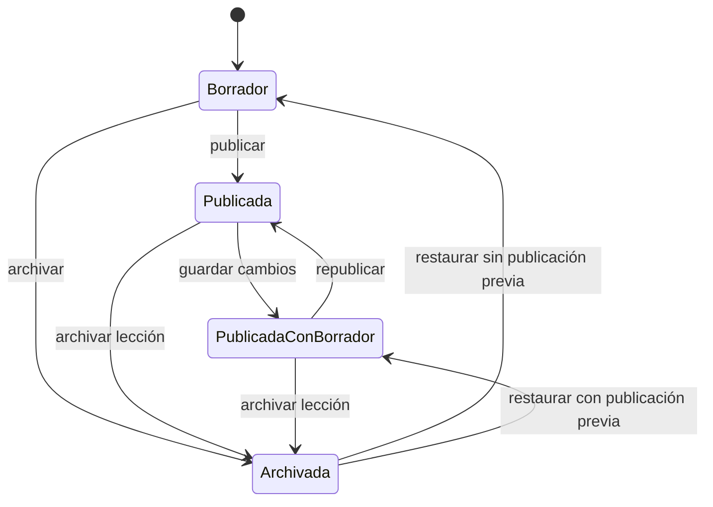

# Cursos para distintas disciplinas

Primera implementación del modelo educativo genérico aprobado. El curso sustituye a la biblioteca y al nivel de inglés como punto de partida del trabajo. La aprobación del usuario incluye la implementación y los diagramas de base de datos; no modifica la aceptación histórica de Sprint 2.

## Qué se puede hacer

- Crear un curso libre, taller, curso escolar, preescolar, universitario o con laboratorio. Son perfiles de presentación, no sistemas de acreditación diferentes.
- Definir el objetivo y elegir cómo llamar a sus agrupaciones: Temas, Experiencias, Unidades, Semanas, Módulos o Prácticas.
- Crear, editar, ordenar y archivar agrupaciones; preparar sus lecciones.
- Crear materiales de texto o enlace sin exigir nivel, habilidad de inglés ni tema predefinido.
- Clasificar cursos y materiales con vocabularios configurados por administración.
- Publicar una lección, compartir su enlace y mantener la última publicación visible mientras se edita el borrador.

No se añaden servicios ni dependencias. Se mantiene React, el Worker y SQLite por organización; las transacciones y las comprobaciones de versión siguen las guías de Cloudflare para evitar sobrescrituras.

## Recorrido del educador



La navegación global muestra Inicio, Cursos y Ayuda. Administración también dispone de Organización, Educadores y Clasificaciones. Dentro de un curso, Contenido muestra la secuencia; Materiales contiene textos y enlaces; Lecciones permite editar; Configuración cambia objetivo, perfil y estado. No hay botones de grupos, programas ni revisión editorial antes de que esas funciones existan.

### Demostración breve

1. Iniciar sesión con el procedimiento de demostración existente y abrir **Cursos → Crear curso**.
2. Escribir un título y objetivo de cualquier disciplina. Elegir un perfil y, si resulta útil, una clasificación.
3. En Contenido, añadir una agrupación. En Materiales, guardar un texto o enlace.
4. Volver a Contenido y seleccionar **Preparar lección aquí**. Definir el objetivo y las actividades; vincular el material del curso.
5. Guardar, publicar y abrir el enlace público. Al modificar el borrador, la publicación no cambia hasta seleccionar **Republicar**.

Los estudiantes no necesitan cuenta. La finalización es un conteo de uso, no evidencia de aprobación ni de estudiantes únicos. Las cuentas compartidas de demo solo admiten contenido sintético.

## Estados realmente disponibles



Son estados de interfaz derivados del borrador, la revisión pública y la marca de archivo. Al archivar **una lección**, su enlace deja de estar disponible. Archivar **un curso o una agrupación** detiene su autoría, pero conserva las lecciones ya publicadas. Archivar **un material** impide nuevos vínculos; las publicaciones conservan su copia. La UI explica esta diferencia.

Los estados de revisión pedagógica, solicitud de cambios y aprobación del diseño general todavía no están implementados. Tampoco hay editor de texto enriquecido, coedición simultánea, programas académicos, requisitos, ediciones, inscripciones ni repositorio compartido entre cursos. No se infieren esas funciones a partir de taxonomías. La prevención de sobrescrituras mediante versiones no sustituye la coedición.

## Diseño visual

| Uso | Color |
| --- | --- |
| Fondo | `#F4F6F5` |
| Superficie | `#FFFFFF` |
| Texto | `#162B33` |
| Texto secundario | `#50636B` |
| Acción principal | `#155E75` |
| Selección suave | `#EAF3F5` |
| Separadores | `#D5DEDC` |
| Contorno de controles | `#788B90` |

Tarjetas espaciadas, títulos de contexto, campos con etiquetas, foco visible y botones de orden accesibles. Sin arrastrar y soltar obligatorio. El recorrido se comprueba en 1365 px y 390 px; la vista de contenido también se verifica sin desbordamiento horizontal a 320 px. No equivale a una certificación de accesibilidad.

Capturas verificadas de [escritorio](curso-escritorio.png) y [móvil](curso-movil.png). Muestran la aplicación y una base local aislada con un curso de fotografía, no producción. Los [wireframes](prototipo-cursos.html) conservan su función de diseño del producto completo.

## Base de datos y compatibilidad

Consultar los [diagramas de base de datos](base-de-datos.md): esquema anterior, curso y materiales, taxonomías, identidad, edición concurrente y modelo objetivo. Incluyen claves, cardinalidades, restricciones, migración y límites del rollback.

Los contenidos y enlaces anteriores se conservan. Se puede entrar a Recursos heredados desde Cursos y a la organización anterior desde Ayuda. No se renombra ni elimina contenido de producción por patrones de nombres. El seed editorial aprobado sigue versionado, sin carga automática: la demo de pruebas no se convierte en datos de producción.

## Comprobación

```bash
./scripts/verify
npm run test:e2e
npm run test:smoke
```

`verify` construye, comprueba tipos, reglas, migraciones y el paquete Workers sin desplegar. Los E2E incluyen cursos genéricos, permisos, aislamiento, edición desactualizada, publicación, recarga, móvil y los recorridos heredados. El smoke de producción permite lectura, inicio y cierre de sesión, pero bloquea la creación de cursos, contenidos y finalizaciones.

La integración utiliza el PR de producto existente. CI publica únicamente su artefacto verificado y comprueba `/api/health`, `/api/version` y los recorridos de lectura. Los tags publicados no se mueven.

Validación local: 28 pruebas Vitest, 16 pruebas Python, 14 pruebas E2E y 2 smoke de lectura aprobados. El recorrido anterior de publicación se conserva; las pruebas nuevas cubren también administración de taxonomías y dos guardados concurrentes sobre la misma versión. La migración compara los bytes publicados antes y después para detectar cambios involuntarios.
