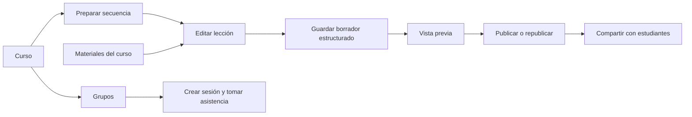

# Cursos como espacio de aprendizaje

El curso es el contexto principal para preparar e impartir una experiencia educativa. La estructura de agrupaciones es configurable; no presupone inglés, niveles escolares ni un sistema de acreditación.

## Flujo de trabajo

Desde el curso, el educador organiza la secuencia, redacta lecciones, reutiliza materiales, crea grupos y registra asistencia. “Contenido” y “Biblioteca” dejan de ser áreas de trabajo separadas; las rutas antiguas redirigen a Cursos y los registros existentes se conservan.



La guía detallada, sus estados de publicación y asistencia, la identidad visual y sus límites están en [Flujos de trabajo de Studio](studio-flujos-y-diseno.md).

## Modelo y persistencia

- Cursos y unidades de aprendizaje; cada curso define su objetivo y el nombre visible de sus agrupaciones.
- Materiales de texto y enlaces asociados al curso.
- Actividades de instrucción, material vinculado o selección única.
- Texto enriquecido por nodos TipTap permitidos. La API valida tamaño, profundidad, tipos de nodo y enlaces; no almacena HTML arbitrario.
- La lección publicada es una instantánea separada del borrador.
- Grupos, listas mínimas, sesiones por fecha y marcas de asistencia.
- Documentos DOCX, PPTX y XLSX en almacenamiento privado de R2. SQLite guarda la organización, el curso, nombre seguro, tipo, tamaño y SHA-256; nunca la ruta pública del objeto.
- Edición colaborativa en vivo del contenido enriquecido de cada actividad. Yjs sincroniza cambios por WebSocket y conserva actualizaciones en el Durable Object de la lección. La presencia muestra a los educadores conectados.

Se conserva SQLite en el Durable Object de cada organización. Las migraciones son acumulativas; la [0008](../../database/migrations/0008_classroom_attendance.sql) agrega asistencia sin reescribir datos previos. Los diagramas de tablas, cardinalidades y claves están en [Base de datos](base-de-datos.md).

## Límites actuales

La biblioteca de materiales admite texto, enlaces y archivos Office de hasta 15 MB. Las vistas previas se procesan en el navegador; el original se descarga como archivo adjunto y no se publica por una URL de R2. Solo una lección publicada que vincule el archivo concede acceso al estudiante. Archivar impide nuevos vínculos, pero no rompe publicaciones anteriores.

Los cuerpos de texto enriquecido se editan simultáneamente: los cambios y cursores se sincronizan entre educadores autorizados. El título, objetivo, orden y estructura de actividades siguen el control de versión del borrador; si alguien los guarda primero, la otra persona debe recargar antes de guardar. Los formularios estructurales no se fusionan en vivo.

El despliegue necesita el bucket privado `happy-learners-demo-course-files` en la cuenta de Cloudflare y el binding `COURSE_FILES`. Conserva la copia de seguridad de SQLite y el inventario/hash de objetos antes de una recuperación. Para revertir, publica una versión de Worker compatible hacia delante y restaura por separado SQLite/R2 solo si se confirmaron daños; no se borra un documento al archivarlo.

La asistencia guarda únicamente el nombre o identificador de lista, grupo, fecha y estado. No se solicitan datos de contacto, edad ni observaciones sensibles. Las cuentas de demostración son compartidas: usar participantes ficticios.

## Verificación

```bash
./scripts/verify
npm run test:e2e
```

La verificación automatizada no equivale a aceptación de producción. La funcionalidad de este cambio requiere integrar la rama, aplicar la migración en el despliegue autorizado y comprobar la UI/API allí antes de considerarla disponible en producción.
