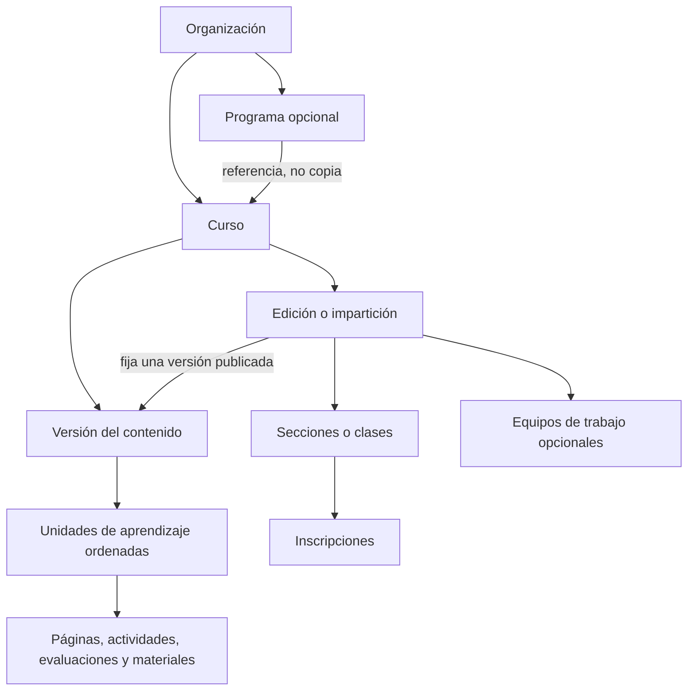
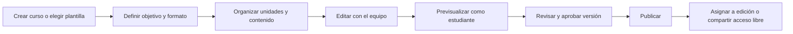
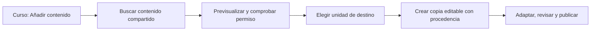
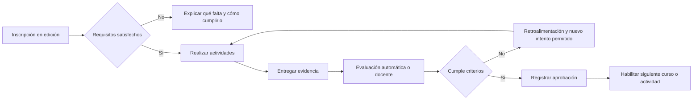
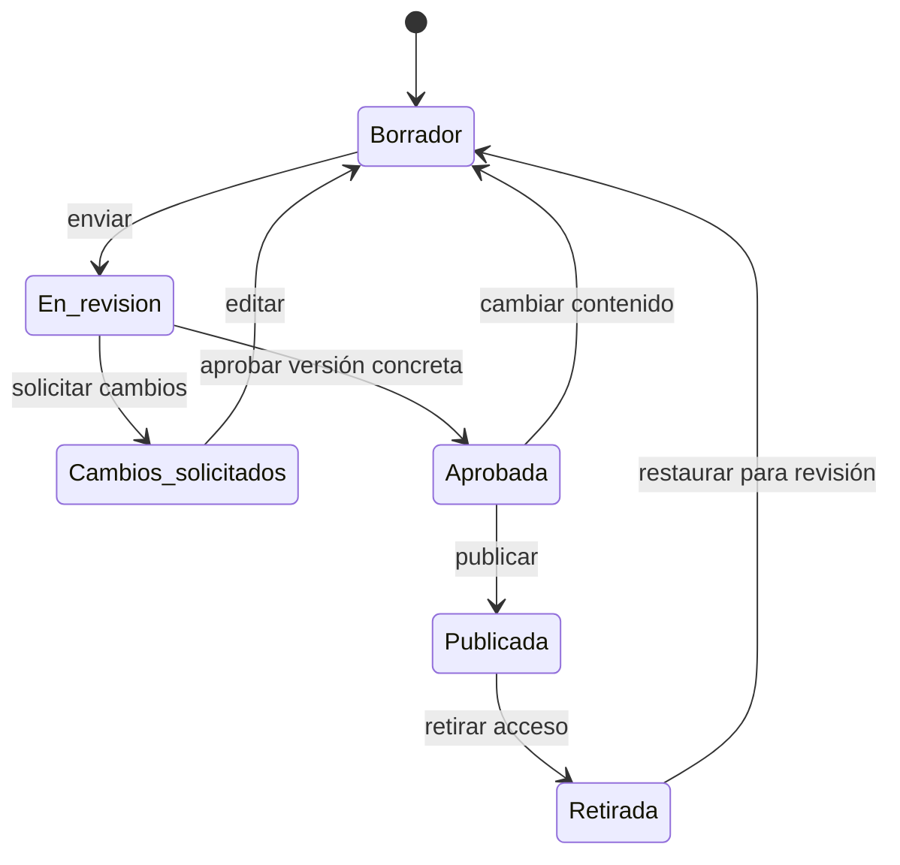
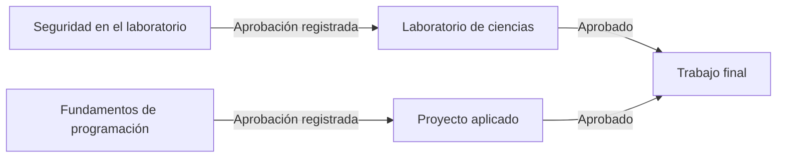
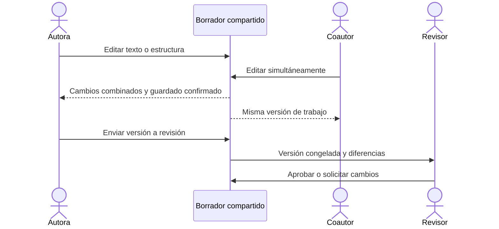

# Cursos, recorridos y contenido compartido

Revisión de producto y UX · 29 de septiembre de 2026

**Estado:** diseño aprobado por el usuario. La [primera implementación](cursos-implementacion.md) cubre cursos, unidades de aprendizaje, materiales, clasificaciones y navegación contextual. Los [diagramas de base de datos](base-de-datos.md) separan el esquema implementado del modelo objetivo. El resto de esta propuesta no debe interpretarse como funcionalidades ya disponibles. Sustituye la jerarquía obligatoria «Nivel → Módulo → Lección» y conserva el inglés como un ejemplo de uso, no como definición del producto.

[Abrir los wireframes navegables](prototipo-cursos.html). Las pantallas ilustran la propuesta; no guardan datos ni simulan una conexión con producción.

## 1. Propósito

Organizar, preparar, impartir y evaluar experiencias educativas de distintas disciplinas. Un equipo pequeño debe poder publicar un curso libre sin configurar una institución universitaria. Una institución debe poder relacionar cursos, impartirlos a distintos grupos y exigir evidencias antes de reconocer su aprobación.

El inglés de San Gaspar es un caso de uso. No determina los tipos, jerarquías, vocabularios ni reglas del núcleo.

### Restricciones observadas antes de esta implementación

- `ResourceSkill` fija cuatro habilidades lingüísticas en `packages/contracts/src/index.ts`. La API también rechaza otros valores en `apps/api/src/content.ts`.
- La migración `0004_curriculum.sql` crea «Beginner» y «Greetings» para cada organización.
- Una lección exige `unitId`; la unidad exige `levelId`. No existen cursos impartidos a una cohorte ni requisitos de aprobación entre cursos.
- La finalización actual es un contador agregado. No acredita aprendizajes individuales.

Cambiar etiquetas o añadir un árbol ilimitado no corrige estas restricciones.

## 2. Qué tomamos de Canvas

La navegación debe mantener el curso como contexto de trabajo, con áreas internas reconocibles. No se necesita copiar todo el menú de Canvas. Se adopta su separación entre navegación global y navegación del curso. [Guía de navegación de cursos](https://community.instructure.com/en/kb/articles/660740-how-do-i-use-the-course-navigation-menu-as-an-instructor).

Los módulos de Canvas organizan materiales por semanas, unidades u otra estructura. Son una secuencia de aprendizaje, no una clasificación fija por nivel de inglés. Adoptamos ese papel con el concepto interno **unidad de aprendizaje** y etiquetas visibles configurables. [Módulos de Canvas](https://community.instructure.com/t5/Canvas-Basics-Guide/What-are-Modules/ta-p/6).

Commons permite encontrar, importar y compartir objetos educativos, incluidos cursos y partes de cursos. Por eso el repositorio compartido será una herramienta de reutilización; crear una clase no obligará a empezar allí. [Canvas Commons](https://community.instructure.com/en/kb/articles/664537-how-do-i-use-commons).

Los requisitos dentro de un curso y la composición de programas son responsabilidades distintas. Canvas Catalog gestiona programas de varios cursos; no debemos atribuir esa función al menú de módulos de Canvas LMS ni asumir que equivale a un sistema completo de gestión universitaria. [Programas de Canvas Catalog](https://community.instructure.com/en/kb/articles/660442-how-do-i-manage-program-requirements-in-canvas-catalog).

La revisión editorial y la coedición descritas aquí son decisiones de Happy Learners. No se presentan como funciones nativas de Canvas verificadas en estas fuentes.

## 3. Cuatro conceptos, cuatro responsabilidades

| Concepto | Responde a | Ejemplo |
| --- | --- | --- |
| Taxonomía | ¿Cómo se clasifica? | Ciencias, educación media, observación, español |
| Estructura | ¿Cómo está organizado? | Curso → Unidad de aprendizaje → Elementos |
| Recorrido | ¿Qué debe completarse o aprobarse primero? | Seguridad aprobada antes de Laboratorio |
| Impartición | ¿Quién lo cursa, cuándo y con quién? | Edición de otoño, sección A, equipo 2 |

La taxonomía no determina permisos, calificaciones ni prerrequisitos. Elegir una plantilla puede proponer una estructura; el educador ve y confirma esa configuración. No se infieren requisitos de aprobación a partir del título, etiquetas o de una respuesta de IA.

## 4. Modelo académico



**Curso.** Espacio estable de autoría y aprendizaje: título, propósito, equipo y configuración. Puede existir sin programa. El término visible puede ser curso, asignatura o taller según el perfil institucional; su comportamiento no cambia por el nombre.

**Unidad de aprendizaje.** Agrupa una secuencia dentro del curso. Su etiqueta puede ser tema, semana, módulo, experiencia o práctica. La primera implementación tendrá una secuencia de unidades y elementos, sin anidamiento ilimitado. Un curso breve puede mostrar sus elementos directamente mediante una unidad predeterminada no visible como trámite adicional.

**Elemento.** Página con texto enriquecido, actividad, evaluación o material. Una actividad puede ser una práctica de laboratorio con instrucciones, recursos, entrega y criterios de evaluación. «Laboratorio» no implica inventar un simulador ni un servicio externo.

**Programa.** Reúne referencias a cursos y reglas de avance o de finalización. Un curso puede ser reutilizado por varios programas sin duplicar su contenido. La disposición en semestres o etapas es presentación; las dependencias forman un grafo separado.

**Edición.** Impartición de un curso en un periodo o modalidad continua. Fija una publicación, docentes y criterios de evaluación. El diseño del curso no se copia para cada grupo.

**Sección o clase.** Agrupación administrativa de inscripciones dentro de una edición. **Equipo de trabajo** agrupa participantes para actividades colaborativas. No son sinónimos de curso, programa o unidad. Esta distinción se apoya en la separación de secciones y grupos de Canvas. [Secciones](https://community.instructure.com/en/kb/articles/661459-how-do-i-use-cross-listing-in-an-account), [grupos](https://community.instructure.com/en/kb/articles/662758-what-are-groups).

**Taxonomías.** Vocabularios por organización, con términos identificados y archivables: disciplina, etapa educativa, competencia, idioma y modalidad. Se permiten vocabularios institucionales adicionales de clasificación; no tipos arbitrarios con lógica ejecutable.

**Requisitos.** Reglas explícitas, versionadas, evaluadas por servidor y con explicación legible. **Evidencia académica** registra el resultado individual que satisface una regla. Nunca se sustituye por el número de visitas.

## 5. Perfiles de inicio, no productos distintos

| Perfil | Etiqueta de unidades | Organización inicial | Seguimiento |
| --- | --- | --- | --- |
| Curso libre | Temas | Contenido directo; programa opcional | Acceso libre o inscripción según el objetivo |
| Preescolar | Experiencias | Actividades guiadas por el educador | Sin notas numéricas por defecto; acceso anónimo disponible |
| Educación media | Unidades | Curso, periodo y secciones | Entregas y criterios explícitos |
| Universitario | Unidades o semanas | Asignatura, edición y programa opcional | Aprobación individual y prerrequisitos |
| Taller práctico | Prácticas | Instrucciones, materiales, ejecución y evidencia | Lista de criterios u observación del educador |
| Curso con laboratorio | Prácticas | Unidades de teoría y práctica en el mismo curso | Seguridad, entrega y aprobación según la actividad |

El idioma y la disciplina son metadatos independientes. Lectura o conversación siguen disponibles en el perfil de idiomas, pero no son campos obligatorios en todos los materiales. Créditos y horas se muestran solo cuando la organización los utiliza. No se confunden horas estimadas con créditos aprobados.

## 6. Navegación centrada en el trabajo

```text
Navegación global
├── Inicio: continuar trabajo y pendientes reales
├── Cursos: mis cursos, compartidos conmigo y archivo
├── Programas: itinerarios y requisitos, si se utilizan
├── Contenido compartido: buscar, previsualizar y reutilizar
└── Administración: organización, vocabularios, accesos y plantillas

Dentro de un curso
├── Vista general: propósito, próxima acción y preparación
├── Contenido: secuencia de unidades y elementos
├── Actividades y evaluación: entregas y criterios, cuando correspondan
├── Participantes: ediciones, secciones y equipos
├── Seguimiento: avance, evidencias y aprobación
└── Configuración: vocabulario visible, navegación y reglas
```

Los borradores y la revisión se gestionan desde el elemento o curso, no mediante otra aplicación. La vista del estudiante oculta autoría y administración. Solo presenta contenido disponible, su siguiente actividad y las razones de cualquier restricción.

### Sustitución de Biblioteca

No se renombra una cuadrícula de recursos y se da por resuelto el problema. Se separan tres lugares:

1. **Contenido del curso:** donde se crea y organiza el recorrido.
2. **Materiales del curso:** archivos, enlaces y recursos usados en ese curso; accesibles desde el editor.
3. **Contenido compartido:** publicaciones reutilizables del equipo, con propietario, versión, permisos y cursos que las utilizan.

La acción **Añadir contenido** ofrece «Crear», «Usar material de este curso» y «Reutilizar contenido compartido». Al reutilizar, se importa una copia editable con procedencia y revisión de origen. Una actualización ofrece comparar y aceptar; nunca sobrescribe cambios locales ni publicaciones en curso automáticamente. Los materiales embebidos en una publicación mantienen una referencia a versión, no al último borrador mutable.

Compartir internamente no significa publicar en Internet. Compartir un objeto, publicar para una edición y permitir acceso público son permisos y acciones distintos.

## 7. Flujos completos

### Preparar e impartir



Salida esperada: una publicación concreta disponible para el público o grupo indicado. Publicar no inscribe a todo el mundo ni hace públicas sus evidencias.

### Reutilizar



### Cursar y aprobar



En cursos libres sin evaluación, el recorrido puede acabar en «Completado», no en «Aprobado». En acceso anónimo no se expiden aprobaciones individuales persistentes.

## 8. Estados que no deben mezclarse

### Estado editorial de una versión



Editar una publicación crea un borrador nuevo, sin cambiar la versión visible. La revisión congela una versión; la aprobación cubre esa versión, no cambios posteriores. Para aplicar una nueva publicación a una edición activa se muestra el impacto y se exige una acción explícita del responsable.

### Estados separados

- Edición: preparación, abierta, en curso, concluida, archivada.
- Inscripción: pendiente, activa, retirada, finalizada.
- Resultado: sin evidencia, en evaluación, aprobado o no aprobado.
- Disponibilidad: calculada a partir de permiso, publicación, fechas y requisitos; no se guarda como otro estado editorial manual.

Un curso publicado puede no estar disponible para una persona. Una actividad completada puede no estar aprobada. Una edición concluida conserva la evidencia; archivar no la borra.

## 9. Progresión y requisitos

Dentro de un curso, las reglas pueden pedir ver un contenido, marcar una actividad como realizada, entregar evidencia, obtener una puntuación mínima o recibir aprobación docente. Estas acciones no se consideran equivalentes. Canvas también distingue requisitos de cumplimiento y prerrequisitos entre módulos. [Requisitos](https://community.instructure.com/en/kb/articles/660897-how-do-i-add-requirements-to-a-module), [prerrequisitos](https://community.instructure.com/en/kb/articles/660896-how-do-i-add-prerequisites-to-a-module).

Entre cursos, la primera entrega de requisitos ofrecerá «aprobar todos» o «aprobar al menos uno», con evaluación final explícita y equivalencias registradas manualmente por personal autorizado. No se construye un editor de fórmulas arbitrarias.



Reglas obligatorias:

- El orden visual no crea una dependencia; mover una unidad no cambia requisitos.
- Rechazar referencias inexistentes, cruces de organización, ciclos y dependencias sobre sí mismo.
- Una regla de aprobación exige una evaluación capaz de producir esa evidencia. Publicar con una condición imposible se rechaza con una explicación.
- Evaluar las reglas en el servidor también al abrir directamente un enlace.
- Mostrar la causa concreta: «Debes aprobar Seguridad en el laboratorio»; no un candado sin salida.
- Versionar reglas y conservar la evidencia que determinó la decisión.
- No bloquear retrospectivamente a participantes que ya cumplieron una versión anterior sin una revisión explícita de impacto.
- Correcciones y excepciones tienen autor, motivo y fecha real. No se fabrican notas ni aprobaciones a partir de visitas antiguas.
- Prerrequisitos para matricularse y requisitos para acceder a una actividad son reglas diferentes. La interfaz indica en qué momento se aplica cada una.

Un plan universitario completo puede necesitar equivalencias complejas, créditos electivos, correquisitos y expedientes oficiales. Queda representable mediante programa, edición y evidencia, pero esas políticas no se declaran implementadas ni se atribuyen al primer incremento. Tampoco se incluyen pagos, admisiones, acreditaciones o expedición oficial de títulos.

## 10. Coautoría

Permisos del curso: administrar, editar, revisar, publicar e impartir. Se asignan a miembros del equipo; no se conceden por una etiqueta. Dos personas pueden trabajar sobre el mismo borrador, incluido el mismo texto, con cambios combinados, presencia, comentarios y recuperación de conexión.



La presencia no demuestra persistencia. Se distingue «guardando», «guardado» y «sin conexión». Un comentario no cambia el contenido público. Revocar acceso impide seguir escribiendo. Los cambios posteriores a enviar una versión a revisión pertenecen a otro borrador y no se pierden ni quedan aprobados implícitamente.

## 11. Identidad y privacidad

Dos modos explícitos:

- **Acceso libre:** sin cuenta obligatoria, progreso de la visita y conteos agregados. Útil para la demo y actividades guiadas. No prueba identidad ni produce un expediente.
- **Aprendizaje con seguimiento:** participante con identificador estable, inscripción y evidencia por edición. Para una demostración se usan participantes sintéticos. Un alias es posible; el correo no es obligatorio por defecto. Las aprobaciones académicas reales requieren una identidad verificada por la organización, no solo un alias autodeclarado.

La API devuelve a cada participante solo sus resultados. El docente accede a las ediciones que tiene asignadas. Los materiales compartidos nunca incluyen inscripciones, notas, nombres de participantes ni evidencias entregadas. Las cuentas públicas actuales de demo no sirven para custodiar expedientes reales; habilitar usuarios reales y sus controles de acceso es parte obligatoria del modo con seguimiento, no una capacidad ya resuelta.

## 12. Diseño de pantalla

La mejora visual se organiza por tareas, no por una nueva cuadrícula de tarjetas:

- **Inicio:** trabajo reciente y pendientes reales. Tarjetas solo para seleccionar cursos.
- **Contenido del curso:** árbol/secuencia compacta, estado textual, acciones contextuales y «Añadir contenido» en el lugar de inserción.
- **Editor:** índice contextual, documento central y panel de revisión a demanda. Herramientas de texto sin exigir HTML.
- **Programa:** vista de lista por etapas y mapa de requisitos. Ambas editan el mismo modelo, sin depender exclusivamente de un diagrama.
- **Contenido compartido:** búsqueda, filtros por disciplina/tipo, vista previa y destino de reutilización.
- **Estudiante:** próxima acción, objetivo y explicación del avance; sin herramientas administrativas.

Los estados no se comunican solo por color. Se conserva foco visible, controles de 44 px, contraste, reordenación mediante botones y lectura a 320 px. En móvil, el índice se despliega a demanda; el usuario no navega tres columnas reducidas. La clasificación académica avanzada permanece oculta hasta necesitarla.

Los wireframes usan fondo neutro, texto oscuro y un acento azul petróleo. Son una propuesta de jerarquía y flujo, no una afirmación de que otro color por sí solo resuelva la UX.

### Sistema visual propuesto

| Uso | Color |
| --- | --- |
| Fondo de trabajo / superficie | `#F4F6F5` / `#FFFFFF` |
| Texto principal / secundario | `#162B33` / `#50636B` |
| Acción principal / selección | `#155E75` / `#EAF3F5` |
| Separador / borde de control | `#D5DEDC` / `#788B90` |
| Foco de teclado | `#7C3AED` |
| Publicado / borrador | `#246347` / `#805418`, siempre con texto de estado |

Tipografía del sistema; base de 16 px. Separación de 24 px entre paneles en escritorio y 16 px entre tarjetas en móvil. La jerarquía depende de títulos, espacio y posición, no de asignar un color a cada funcionalidad. Las tablas se reservan para requisitos y comparaciones; el contenido del curso utiliza filas ordenadas.

### Recorridos del prototipo

- Cursos → Crear curso: cambiar el perfil y comprobar que propone vocabulario sin inventar requisitos.
- Cursos → Observar el entorno: reconocer el objetivo, la secuencia y la siguiente acción.
- Añadir contenido → Contenido compartido → Autoría: ver el destino y la procedencia antes de reutilizar.
- Autoría → Revisión → Impartición: distinguir borrador, aprobación, publicación y audiencia.
- Programas: comprender un requisito por el gráfico o por su lista equivalente.
- Vista del estudiante: encontrar instrucciones sin exigir datos personales en acceso libre.

El prototipo no incluye autenticación, persistencia, evaluación ni coedición real. Tampoco reemplaza las pruebas de usabilidad con educadores. La disponibilidad de dispositivos y conectividad sigue siendo una pregunta abierta; comprobar 320 px no resuelve esa investigación.

Capturas del prototipo, no de producción: [contenido en escritorio](prototipo-curso-escritorio.png) y [contenido en móvil](prototipo-curso-movil.png).

## 13. Migración sin pérdida de datos

1. Inventariar programas, niveles, unidades, lecciones, recursos y publicaciones actuales. Registrar una correspondencia explícita; no equiparar automáticamente un `program` heredado con un programa universitario.
2. Añadir cursos, versiones, vocabularios y relaciones mediante migraciones acumulativas. Conservar IDs anteriores en una correspondencia estable; no regenerarlos por estética.
3. Interpretar «Beginner» como clasificación del perfil de idiomas. Vincular las unidades y lecciones al curso adecuado según su procedencia. No crear un curso por cada nivel sin evidencia.
4. Llevar las habilidades actuales al vocabulario de idiomas y mantener lectores de compatibilidad para publicaciones históricas. Conservar los pasos ordenados de las lecciones actuales dentro de una actividad compuesta; no aplanarlos perdiendo instrucciones, orden o enlaces públicos. La unidad del curso agrupa esos elementos, sin introducir un árbol de carpetas ilimitado.
5. Conservar enlaces y snapshots publicados. No convertir finalizaciones agregadas en notas, inscripciones o aprobaciones individuales.
6. Incorporar el seed pedagógico ya aprobado como contenido de un curso de ejemplo. No volver a solicitar su revisión pedagógica. Las nuevas demostraciones de otras disciplinas tendrán su propia revisión; no heredan esa aprobación.
7. Archivar únicamente registros de pruebas identificados mediante evidencia. No eliminarlos por coincidencia de título.

Rollback: la lectura anterior y los enlaces públicos siguen disponibles durante la transición. Antes de retirar compatibilidad, verificar restauración y correspondencias en una copia aislada. No ejecutar esta migración documentalmente: requiere código, pruebas de datos y una entrega de producto separada.

## 14. Secuencia de implementación corregida

1. **Curso como centro de trabajo:** contrato y persistencia aditivos, navegación contextual, materiales del curso y vocabularios configurables. Aceptación: crear inglés, fotografía y ciencias sin modificar código ni completar campos lingüísticos obligatorios.
2. **Autoría y reutilización:** editor enriquecido, secuencia de unidades/elementos y copias con procedencia. Aceptación: crear contenido desde un curso y reutilizarlo en otro sin sobrescribir el original.
3. **Revisión y coedición:** permisos por curso, versiones, revisión y trabajo simultáneo persistente. Aceptación: dos autores editan el mismo texto y la publicación anterior no cambia hasta aprobar/publicar la nueva.
4. **Impartición y evidencia:** ediciones, secciones, inscripciones mínimas y evaluación. Aceptación: la misma publicación sirve a dos secciones con seguimiento separado.
5. **Programas y progresión:** reglas dentro y entre cursos, mapa de requisitos y motivos de restricción. Aceptación: un curso no se desbloquea por visitar un enlace; exige evidencia válida de aprobación.

La primera entrega visual desplegada se conserva como base, pero su modelo académico no se considera definitivo. Este documento orienta la implementación siguiente; no reabre sprints cerrados ni cambia estados Jira retrospectivamente.

## 15. Criterios del rediseño completo

- Un curso libre no exige programa, nivel educativo, créditos ni evaluación.
- Ningún campo del núcleo impone disciplina o idioma.
- Un curso se puede impartir más de una vez sin mezclar participantes ni resultados.
- La estructura visible y las dependencias son independientes y coherentes entre lista y diagrama.
- La autoría comienza dentro del curso, sin un paso obligatorio por Contenido compartido.
- El usuario puede explicar qué está editando, para quién será visible y qué falta para publicar.
- Un autor puede continuar tras recargar; dos autores no pierden cambios al editar simultáneamente.
- Las reglas académicas se aplican en servidor y se pueden explicar con su evidencia.
- La migración conserva enlaces, identidades, contenido y publicaciones existentes.
- Las pruebas mutantes permanecen aisladas de producción.

## 16. Verificación de esta propuesta

El 29 de septiembre de 2026 se comprobaron once pantallas del prototipo a 1440, 1024, 390 y 320 px: 44 combinaciones sin desbordamiento horizontal. Pasaron navegación, recarga, Atrás, búsqueda, cambio de vocabulario por perfil, acceso mediante teclado, foco visible, IDs únicos y enlaces locales. No hubo errores JavaScript ni peticiones a servicios externos.

`./scripts/verify` aprobó compilación, generación de tipos, análisis TypeScript, 23 pruebas Vitest, 13 pruebas Python y empaquetado sin despliegue. Estas pruebas protegen el producto existente; no demuestran que el nuevo dominio académico esté implementado. `git diff --check` también pasó.

No se modificaron datos, APIs, migraciones aplicadas, Jira, tags ni producción. La especificación, los wireframes y sus capturas son el resultado de esta revisión. El registro canónico y los documentos de la entrega anterior conservan su historia; esta propuesta no incorpora capacidades futuras como si ya estuvieran entregadas.
