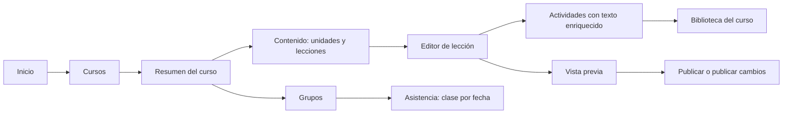
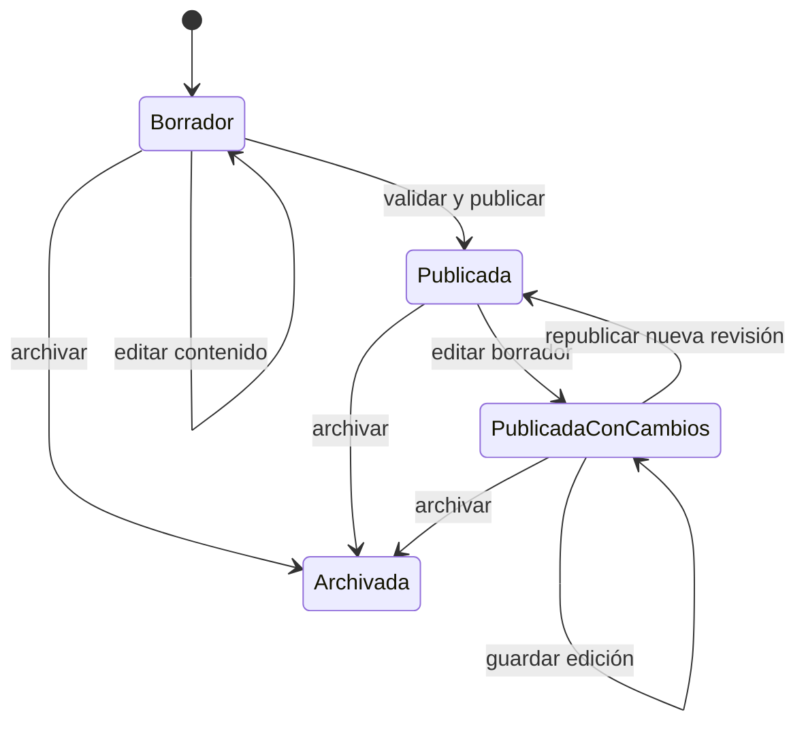
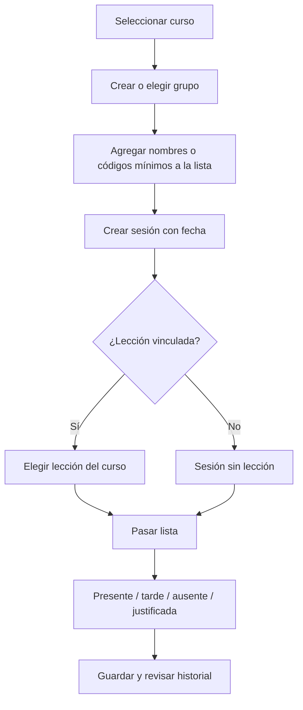

# Happy Learners Studio: flujos de trabajo

La interfaz organiza el trabajo por curso, no por tipo de registro aislado. El educador prepara la secuencia, redacta la clase, consulta sus materiales y toma asistencia en el mismo contexto.

## Mapa de navegación

Un solo sistema de navegación: el sidebar global (Inicio, Cursos, Biblioteca, Ayuda) cambia al entrar en un curso por Todos los cursos, Resumen, Contenido, Biblioteca del curso, Grupos, Asistencia y Configuración. Las rutas de v0.2.2 (Preparar, Materiales, Editar lecciones) redirigen a sus equivalentes. Detalle en la [arquitectura de información v0.2.3](arquitectura-informacion-v0.2.3.md).

## Publicación de una lección

El editor usa un documento estructurado de TipTap. El servidor limita los nodos y formatos permitidos; no acepta HTML libre. La publicación guarda una instantánea separada para que un borrador posterior no cambie lo que ya ve el estudiante.

“Publicada con cambios” se deriva de las versiones del borrador y de la instantánea; no es una etiqueta editable. Publicar requiere título, objetivo, actividades válidas y materiales pertenecientes al curso. La vista pública solo recibe la instantánea publicada.

## Preparar una clase

La hoja inicia en “Sin marcar”. Solo después de elegir un estado se guarda el registro. El educador puede corregirlo más tarde. La asistencia se limita al curso y sus educadores; no pide correo, teléfono, fecha de nacimiento, fotografías ni notas personales. Los registros de demostración usan cinco participantes ficticios.

## Sistema visual

El tema completo vive en `apps/web/src/theme.css` (tokens) y `apps/web/src/style.css` (componentes, que solo leen tokens). Tipografías autoalojadas: Inter para texto y Plus Jakarta Sans para títulos.

**Neutros:** tinta `#141729`, texto secundario `#5B6180` (≥ 5.3:1), lienzo `#F5F6FB`, superficie `#FFFFFF`, bordes de control `#8A8FA8` (≥ 3:1).

**Familias de tono.** Cada una tiene `vivid` (solo decoración), `ink` (texto e iconos, ≥ 5.3:1 sobre blanco y sobre su tinte), `soft` (fondo) y `solid` (relleno con texto blanco, ≥ 4.5:1). Una clase `tone-*` recolorea cualquier componente.

| Tono | Ink | Soft | Uso principal |
| --- | --- | --- | --- |
| Violeta (marca) | `#4B36CC` | `#EEEBFF` | Acción principal, Inicio, Resumen, foco |
| Cielo | `#1A5CC0` | `#E3F0FF` | Cursos, Contenido, actividad de contenido, recursos de texto |
| Turquesa | `#0B6F66` | `#DDF7F3` | Biblioteca, actividad de recurso |
| Rosa | `#AE2574` | `#FDE6F2` | Grupos, preguntas |
| Coral | `#B2381C` | `#FFEDE7` | Asistencia, enlaces |
| Ámbar | `#8A5200` | `#FFF3D6` | Ayuda, borradores, documentos (nunca con texto blanco) |
| Verde | `#16703F` | `#E2F6EA` | Publicado, presente |

Los cursos y unidades reciben un tono estable según su identificador, para reconocerlos de un vistazo. El color siempre acompaña a un texto o icono; nunca comunica solo. Degradado de marca: `#4B36CC → #7A2FC4 → #AE2574` (texto blanco ≥ 6.2:1).

**Forma y espacio:** retícula de 4 px, radios 8/12/16/22 px, sombras suaves teñidas de violeta, controles de 42 px y objetivos táctiles de 44 px. **Movimiento:** 120/200/320 ms, desactivado con `prefers-reduced-motion`.

**Editor de texto:** barra de herramientas tipo documento (deshacer/rehacer, estilos de párrafo, formato, listas, cita, enlace), navegable con flechas; el contenido se edita sobre una "hoja" blanca con ancho de lectura, marcador de posición y contador de palabras.

Las pruebas E2E auditan WCAG 2.2 A/AA con axe en todas las rutas principales.

## Archivos de clase y coedición

DOCX, PPTX y XLSX se guardan en R2 privado. Cada carga valida extensión, MIME, tamaño, firma ZIP, entradas, rutas y límites de expansión; calcula SHA-256 y se vincula con organización y curso en SQLite. Los binarios nunca usan una URL pública de bucket. La vista previa se genera en el navegador con parsers cargados bajo demanda y sanitización de HTML/SVG. Solo se publica un archivo si una actividad de una lección lo referencia.

Al abrir una lección guardada, cada actividad obtiene un documento Yjs compartido. Un Durable Object por lección sincroniza cambios y presencia sobre WebSocket, comprueba sesión, rol y curso en cada conexión y mensaje, limita tamaño y frecuencia, y persiste operaciones en SQLite con compactación periódica. La presencia expira al procesar mensajes o abrir una conexión; el servidor no mantiene intervalos que impidan la hibernación de una sala sin actividad. Al guardar, el Worker toma la instantánea colaborativa para evitar enviar una copia desactualizada.

La coedición cubre el texto enriquecido y los cursores de los educadores. Título, objetivo, orden y demás estructura de la lección se guardan con compare-and-write; si cambió en otra sesión, se pide recargar. No se fusionan en vivo formularios estructurales.

Antes de desplegar, el bucket R2 `happy-learners-demo-course-files` debe existir en la cuenta destino. La configuración declara el binding, pero no crea el recurso ni habilita facturación. Mantén la copia de seguridad de SQLite y los metadatos SHA-256; archivar un documento no borra el objeto ni invalida publicaciones existentes.

## Referencias de interacción

El editor de formato y la separación entre materiales del curso y contenido publicado siguen patrones reconocibles de LMS; la marca, el lenguaje y la paleta son propios de Happy Learners. Referencias: [Canvas Rich Content Editor](https://community.instructure.com/t5/Canvas-Basics-Guide/What-is-the-Rich-Content-Editor-RCE/ta-p/12), [Canvas Course Files](https://community.instructure.com/en/kb/articles/662754-what-are-files).
